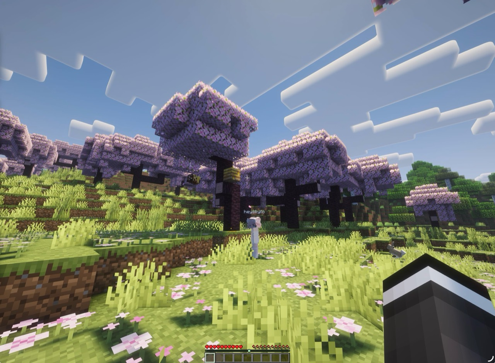
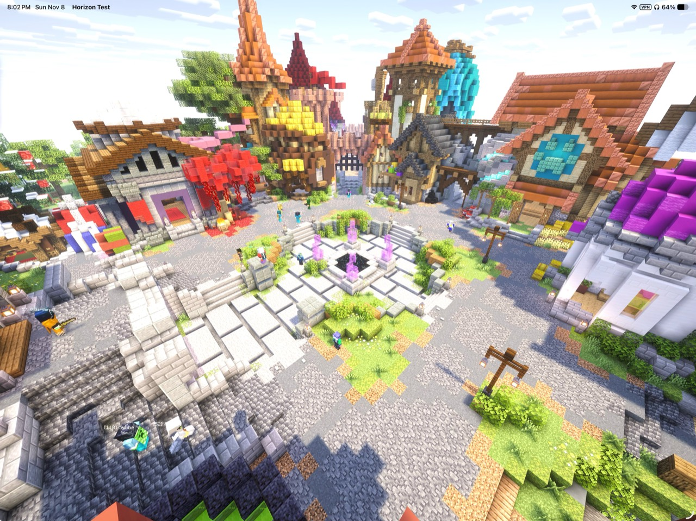

# Horizon for iOS & iPadOS

Minecraft: Java Edition 26.3 on iPhone and iPad, powered by [Horizon's Rust engine](https://github.com/horizon-rust/horizon).

This community mobile port combines native Metal rendering with a SwiftUI launcher built for both phone and tablet layouts. The game runs natively on the device without a Java runtime.

**This is an experimental port under active development.** This README describes the current development tree; downloadable builds may lag behind it. Device, server, resource-pack and shader compatibility are still being tested.

> Unofficial Minecraft software. Not approved by or associated with Mojang or Microsoft. Minecraft's code and assets belong to their respective owners; Minecraft assets are not included in this repository. Use Horizon with your own licensed copy of Minecraft: Java Edition.

[Builds](https://github.com/heyskylo/horizon-ios/actions/workflows/ios.yml) · [Releases](https://github.com/heyskylo/horizon-ios/releases) · [Report an issue](https://github.com/heyskylo/horizon-ios/issues) · [Upstream Horizon](https://github.com/horizon-rust/horizon)

## On iPad





Lighting and appearance vary with shader packs and settings.

## Made for mobile

- **Native launcher:** adaptive iPhone and iPad layouts
- **Touch and external input:** on screen movement and camera controls, hardware keyboards, mouse/trackpad, and controller support
- **Microsoft accounts:** sign in for online servers, keep multiple accounts, switch the account used for the next game session. Offline profiles remain available for local play.
- **Packs:** manage resource packs and shader packs from the launcher. Shader packs run through Horizon's own translation and rendering layer; results vary by pack and device.
- **External displays:** AirPlay and external display support, including launcher aware game presentation.

## Install a build

The deployment target is **iOS/iPadOS 16.0 or later** on ARM64 devices. That is a minimum build target, not a guarantee that every supported device can run every world or shader pack. Available memory and GPU capabilities matter.

1. Check [Releases](https://github.com/heyskylo/horizon-ios/releases) for published IPAs, or open a successful run of the [iOS build workflow](https://github.com/heyskylo/horizon-ios/actions/workflows/ios.yml).
2. For a workflow build, download the **`horizon-ios-game`** artifact and extract **`Horizon-game-unsigned.ipa`**. GitHub may require sign-in to download artifacts, and older artifacts expire.
3. Sign the IPA with your own compatible signing setup, then install it on your iPhone or iPad.

## First launch

1. Open Horizon and let the automatic game-file download and installation finish.
2. Open the account control to sign in with Microsoft, or use an offline profile for local play.
3. Press **Play**, then choose **Singleplayer** or **Multiplayer** inside the game.

Online mode servers require a Microsoft account that owns Minecraft: Java Edition, with multiplayer permitted for that account.

Prepared game files come from the [download source configured in the build](crates/horizon-client/src/import/download.rs). If automatic setup fails, **Settings → Game files** provides a retry and a custom download-link option for a prepared ZIP. See [resource preparation](docs/native-client.md) for the upstream preparation workflow.

## Resource packs and shaders

Use the launcher's **Packs** page to manage installed packs. Server resource pack prompts appear in the game, where you can accept or decline them.

Shader support is experimental. Complementary Reimagined and Solas have been exercised during development, but support for a pack does not establish that every effect, profile or version renders correctly. Heavy packs can exceed a device's GPU or memory limits. Start with a modest render distance and test packs individually.

The game's saves, options and pack folders live in the app's Documents directory. Where file sharing is available, this is accessible through the Files app. Keep backups of worlds before testing development builds or changing packs.

## Current limitations

- Bugs and differences from vanilla Java remain. This port does not claim complete Java parity or universal server compatibility.
- New upstream engine changes can need additional mobile integration and testing.
- Shader effects and resource-pack features may be incomplete or unsupported on a particular GPU.
- Java mod `.jar` files do not run directly in this app. Horizon's own mod systems are separate; the mobile launcher does not provide the desktop launcher's native-mod build workflow.
- Simulator results are useful for UI and regression work, but do not establish performance or compatibility on a physical device.

For recent investigated issues and validation scope, see the [bug-sweep report](docs/ios/item-integrity-sweep.md). Report new problems in [this mobile fork's issue tracker](https://github.com/heyskylo/horizon-ios/issues).

## Report a bug

Please include:

- Device model and iOS/iPadOS version.
- App version/build number and where you obtained the IPA.
- Steps to reproduce, expected behaviour, and what happened instead.
- Whether it happens in singleplayer, on LAN, or on a named server.
- Resource/shader pack names, versions and settings, if relevant.
- A screenshot or recording, plus a crash log if available.

For input problems, mention whether you were using touch, a controller, or a keyboard and mouse. Remove account tokens, signing files and other private information from anything you attach.

## Build from source

You need a Mac with **Xcode 26 or newer and the iOS 26+ SDK**, Rust stable, the iOS ARM64 target, and [XcodeGen](https://github.com/yonaskolb/XcodeGen). The app's deployment target remains iOS 16; the newer SDK is needed to build the native launcher.

```sh
git clone https://github.com/heyskylo/horizon-ios.git
cd horizon-ios
rustup target add aarch64-apple-ios
brew install xcodegen
cd packaging/ios
xcodegen generate
open HorizonIOS.xcodeproj
```

Select the **Horizon game** scheme, choose your device and signing team, and build. The project builds the Rust engine and embeds the native launcher. The separate **Horizon shell** target is a diagnostic probe, not the playable app.

For the unsigned CI packaging steps, use [`.github/workflows/ios.yml`](.github/workflows/ios.yml) as the reference. It builds the game with `--no-default-features --features audio,horizon-extras` for `aarch64-apple-ios` and packages the `HorizonGame` target.

Mobile builds include the public application ID used by the official Horizon launcher. The iOS workflow supplies it through `HORIZON_MSA_CLIENT_ID` and writes `HorizonMSAClientID` into the app's Info.plist. Custom build tooling may supply an explicitly approved application ID. Keep personal signing material and account credentials out of source control. See [Microsoft authentication](docs/microsoft-account.md) for the authentication flow.

The [native launcher preview](packaging/ios/Preview/README.md) supports simulator UI development with sample data. It does not launch the game.

## Contributing

Read [CONTRIBUTING.md](CONTRIBUTING.md) and [AGENTS.md](AGENTS.md). Gameplay fixes should follow the matching Java version and include a regression that demonstrates the problem and the repaired behaviour. Mobile changes should account for touch, external input, orientation, app lifecycle and device resource limits.

```sh
python3 tools/pr_ready.py --quick
```

This runs the quick local checks. Also run the tests and device/simulator checks relevant to your change; the quick check alone is not proof of mobile compatibility. Do not commit prepared game files, Minecraft assets, certificates or account data.

How Horizon is run (the council, theme groups and their leads, the Horizon Team, moderation): [GOVERNANCE.md](GOVERNANCE.md).

## Credits and license

This fork builds on [Horizon](https://github.com/horizon-rust/horizon), created by **Ludovic Marie** and the Horizon contributors. The iOS/iPadOS port is developed in [heyskylo/horizon-ios](https://github.com/heyskylo/horizon-ios) by its maintainers and contributors.

Original project code is licensed under [MIT](LICENSE). Dependencies retain their own licenses; see [third-party notices](THIRD_PARTY_NOTICES.md).
