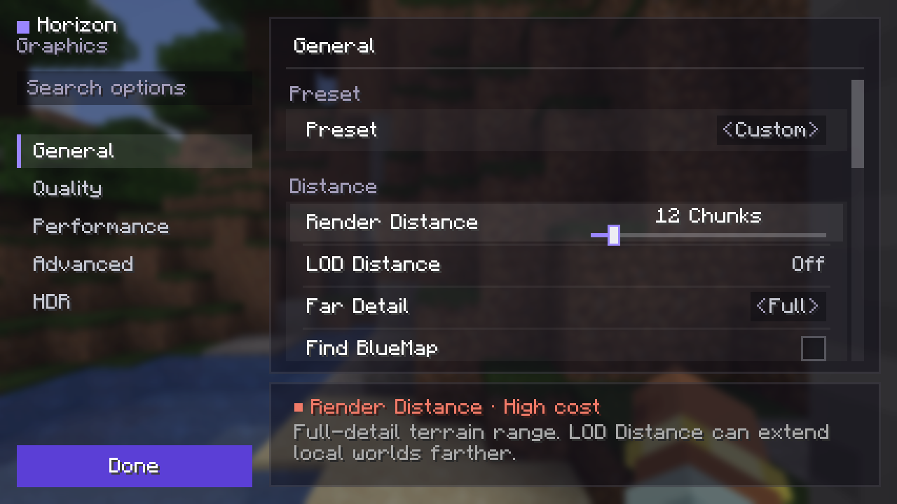

# Graphics: settings and performance

## Settings

Horizon's graphics settings are one screen, and **Options → Video Settings...** opens it, as Sodium's video screen replaces vanilla's: it holds every row of vanilla's Video Settings (with vanilla's names and values, kept in `options.txt` under vanilla's keys), Horizon's own graphics settings, the extras that change the picture (fullbright, dynamic lights, hiding block-break particles) and the shader packs. Each setting is in one place: FOV stays on the Options screen and View Bobbing in Accessibility, where vanilla has them; vanilla's Graphics API button is Advanced's Graphics API. The HDR shortcut key opens it at HDR. `horizon-ctl options video-vanilla` still shows vanilla's own Video Settings layout, which no menu opens.

The screen holds vanilla's video options and Horizon's own together, built from Minecraft's own screen patterns in the design system's Blocks palette (`docs/design-system.md`), on see-through panels so the world stays in view:

- Down the left, under the Horizon mark: the search field, the pages (General, Quality, Performance, Shaders, Advanced and HDR) as a column of names, and **Undo** and **Done** at the foot.
- On the right, a plate shows the open page alone, under its name: its settings in titled groups (Distance, Display, Culling...), each group on a panel of its own. A row has the setting's name on the left and its control on the right: a tick box for on and off, a value between arrows that a press steps through, a value whose slider (a thin track under the value) shows while the row is pointed at or focused. A setting that can't be used now is greyed.
- The search field shows the settings of every page whose name or description has the words typed, under their page's name; picking a page then scrolls to its matches.
- A strip under the plate holds the hovered or focused setting's name, its cost in frame time (no cost, low, medium, high, or saves time for culling that makes frames faster) and what it does; with none, what the open page holds.
- Undo shows once something changed; it puts back every setting as it was when the screen opened.

Tab, the arrows, Enter and Space work it from the keyboard (Left and Right step a focused slider, Space lets go of it), a controller moves between its rows and its bumpers between the pages, and the narrator reads each row as a tick box, a slider or a button.

Every setting applies at once, except worker threads, the graphics API and translucent batching, which apply at the next start. A preset sets the quality settings together; changing one of them turns it into Custom. Display preferences (FOV, framerate, VSync, GUI scale, fullscreen, present mode, pacing) leave the preset as it is.



| Page | Setting | Stored in |
| --- | --- | --- |
| General | vanilla's graphics preset, render distance, simulation distance, brightness, GUI scale, fullscreen, exclusive fullscreen and its mode, VSync, max framerate, inactivity framerate, menu background blur, attack indicator, autosave indicator | `options.txt` (vanilla keys) |
| | preset, LOD distance, far detail, BlueMap finding and radius (on servers, at the next join) | `horizon-graphics.txt` |
| Quality | clouds, cloud distance, weather radius, particles, smooth lighting, biome blend, entity distance, entity shadows, vignette, chunk fade, mipmap levels, texture filtering, max anisotropy, cutout leaves, improved transparency | `options.txt` |
| | hide block-break particles, dynamic lights, fullbright ([extras.md](extras.md)) | `horizon-extras.txt` |
| | sky, fog, weather, animated textures, distant plant dither (`ditherCutoutMips`, off by default: cutouts from 64 texels up), resolution scale, anti-aliasing (FXAA or TAA), TAA upscaling, screenshot quality, frame generation | `horizon-graphics.txt` |
| Performance | chunk builder | `options.txt` |
| | chunk updates and upload budget per frame, worker threads, cave culling, GPU culling, entity and particle culling modes, leaf culling, battery mode, and the block-entity caches (shulker boxes, signs, decorated pots, bells, chests, banners, copper golem statues) | `horizon-graphics.txt` |
| Shaders | **Shader Packs...**: the list of shader packs, Horizon's `.hshader` ones and `shaders/` folder ones ([shaders.md](shaders.md)), and the picked pack's options; shadow cache | `horizon-graphics.txt`, the pack's own options file |
| Advanced | present mode, frame pacing, graphics API, translucent batching, performance overlay (FPS, frame/CPU/GPU times, frame-time graph) | `horizon-graphics.txt` |
| HDR | HDR, calibration, black level, peak brightness, paper white, UI brightness, a shortcut key to the page | `horizon-graphics.txt` |

`options.txt` keeps exactly vanilla's keys and values, so the options harness still compares it with vanilla; Horizon's settings live in `horizon-graphics.txt` beside it. Their defaults render as vanilla does: cave culling on, GPU, entity, particle and leaf culling off, no upload budgets, sky, fog and weather on, 100% resolution, no anti-aliasing, HDR off, the present mode following VSync. VSync on always waits for the display (Fifo), in a window and in fullscreen, as in vanilla; the present mode setting chooses how frames are shown only while VSync is off. Frame pacing defaults to Efficient: the limiter sleeps through the last half millisecond where vanilla spins, and paces frames on a fixed grid of slots (vanilla starts each slot when the thread wakes up, so every late wake-up lengthens a frame), which changes timing, not pixels.

**Entity Culling** is off by default and disabled with non-vanilla resource packs. It applies to entity models; block entities keep their section and per-block frustum culling and use the separate Block Entities caches. Synchronous mode checks conservative render bounds and refines visible candidates against the same-frame mesh. Asynchronous mode checks bounds and meshes on a worker; hidden answers are reused only for the exact camera position and outward-quantized query bounds, and only while the opaque chunks and rendered sections that proved occlusion remain unchanged and ready. Stale or pending results leave the entity visible. In Asynchronous mode, **Entity Culling Precheck** sets the loaded-mob count at which the coarse mob AABB pass starts; zero disables that pass. It does not disable asynchronous culling of other entity types. Both modes leave simulation and interaction unchanged; older `entityCulling:true` settings select Synchronous.

**Particle Culling** is off by default. Synchronous and asynchronous modes skip particles outside the camera frustum, below half a projected pixel, or hidden by opaque terrain. Asynchronous mode defers occlusion checks and leaves particles visible until a current result is available. Particle simulation is unchanged.

**GPU Culling** (Performance, after Cave Culling; Off, On or Auto, off by default, `gpuCulling` in `horizon-graphics.txt` as `false`, `true` or `auto`; it applies at once and is no part of a preset) is for a fast GPU at high render distances, where the render thread is the frame. A compute pass decides for every resident section with solid quads what the CPU's walk decides (the render distance, cave culling, the view, the sides that can face the eye) and writes its draws, and each page of the section arena is drawn with one count draw, instead of lists the render thread sorts, groups and encodes. The picture is the same, except that where faces of two sections meet at exactly the same depth the other one can win the pixel, the same way every frame. On Vulkan its frames run occlusion culling too, the same two-phase test with each section's part decided on the GPU (the sections whose box the last test saw first, then those this frame's test finds in sight), under the same gate as CPU frames; elsewhere they run none. The GPU does more: where it is the limit (4K, a slower GPU) frames can be slower, hence off by default. **Auto** leaves the choice to the frames: in a settled world it takes the median CPU time and the median GPU time of each 240 frames (the CPU's without its waits), and when the CPU's is at least 1.5 ms and over 1.3 times the GPU's in two windows running it turns GPU Culling on, leaves the next window out while that settles, and measures again. It keeps it if the busier of the two dropped under 97% of what it was, and otherwise switches it off and doesn't try again for 5 minutes of play, after a second rejection 20, and after a third not before the next start. A GPU whose frames can't be timed, or a machine that isn't offered GPU Culling, stays Off, and so does one whose GPU is the slower side, such as a GPU-bound laptop or an old card at 1080p. The status's `gpu_culling_mode` and `gpu_culling_auto` (`watching`, `trial` or `kept`) say where it is. Translucent quads, sections fading in or out, distant terrain and the columns past the render distance stay on the CPU, and frames with a `shaders/` pack's terrain or shadow pass, the `[shadow]` pass, `[displacement]` or water mirror of one of Horizon's own packs, or the title screen take the CPU's path whole. It needs a GPU that draws a count it wrote (Vulkan with `VK_KHR_draw_indirect_count`) and compute shaders: OpenGL, Metal, Intel Gen11 and Gen12 on Vulkan, devices whose vanilla frames draw flat and software rendering (WARP, lavapipe, where the pass would run on the CPU too) don't offer it, nor, for now, DirectX 12, whose count draws lose each draw's base vertex, by which the near sections' packed faces are read. There the switch is greyed out, reads Off and says why, and the saved value waits; macOS doesn't show it. If its buffers stop fitting in video memory, or the graphics device is lost in one of its frames, it switches itself off until the next start, and the switch says so. In its frames F3's `C:` count and the draw statistics come from the GPU's own counts, read back once the frame is done, a frame or a few late (the status's `stats_lag`): at the edges of the view they can count a few sections more than without it, which the GPU's whole-block test keeps and draws. `gpu-culling on|off|auto` over the control socket sets it, unsaved, for A/B checks.

**Battery mode** (Performance, off by default) is for laptops and handhelds: at most 60 frames per second in a world, 30 in menus without a world or while another window has focus, and half the automatic worker threads (chunks load slower). It changes only when frames are drawn: what they show and the game's 20 ticks per second stay as they are.

**Block Entities** (Performance, after Culling) has separate switches for shulker boxes, sign text, decorated pots, bells, chests, banners and copper-golem statues. The model caches are off by default; the sign-text cache stays on by default as before. Settled shulkers, pots and bells, closed chests, and statue geometry are cached; active animations keep their regular path. Banner poles are cached while flags and patterns still update. Nearby static models are prepared independently of the block-level frustum and stored in per-section GPU buffers, including when entity culling is enabled. Camera motion updates one shared transform containing the integer camera block and its fractional offset; the shader subtracts section origins in integer coordinates before converting to floats. Camera rotation changes only the visible section draw list. Mesh/light and block-entity membership revisions invalidate only their own section, and membership reconciliation runs only when the global membership revision changes. Each new atlas identity invalidates cached UV geometry even when sprite rectangles are unchanged. The static pipeline skips blending for opaque and cutout models; resource-pack sprites with fractional alpha stay on the ordinary blended path. The benchmark summary reports snapshot rebuilds, CPU snapshot bytes, GPU bytes written, and static/dynamic block entities drawn. This remains a separate entity draw, not geometry merged into terrain section meshes. When shader-pack callbacks are required, cached model vertices use the regular per-frame entity buffer instead. Sign text also remains in the regular entity buffer, using its existing CPU geometry cache. Beds and sign boards already use the terrain's block models in 26.3; Mojang removed the bed block entity and moved beds and signs to block models in 26.2 ([release notes](https://www.minecraft.net/en-us/article/minecraft-java-edition-26-2)), so they have no separate renderer cache switch.

**Translucent batching** (Advanced, after Graphics API; on by default, `batchTranslucent` in `horizon-graphics.txt`, a new key so that the `translucentBatching:false` earlier builds saved for everyone doesn't keep it off; it applies at the next start or resource reload, and is no part of a preset) gives water, glass, ice and other translucent quads a vertex buffer of their own, with pages up to 2 GiB, and their sorted indices the same: the back-to-front list then stays in one page and goes out in a few draw calls instead of switching pages every few sections. The picture is the same and frames come faster, most over water and at high render distances (RTX 4090 at 1080p: 4 to 16% more FPS at render distance 32; over the ocean at 64, 354 draw calls a frame instead of 3,832 and 43% more FPS); it costs a little video memory, as solid and translucent quads no longer share free space (terrain meshes take 1 to 15% more at render distance 32, 5 to 10% more at 64). The large pages shrink once the view has settled (a second after terrain stops arriving): one much larger than what it holds, as after a teleport or a lower render distance, moves into a page of the right size, about 32 MiB a frame. It needs indirect multi-draw that isn't OpenGL's (which loops over the entries on the CPU), and devices whose vanilla frames draw flat (Metal, Intel Gen11 and Gen12 on Vulkan) don't offer it: there the switch is greyed out and reads Off, and macOS doesn't show it. A `shaders/` pack's terrain and shadow passes, and the `[shadow]` pass of one of Horizon's own packs, draw flat where the device can, reading translucent quads beside their section's solid ones: while such a pack runs they go back there. Such a pack picked at the start has the world laid out for it from the first; switching to or from one later meshes the world again.

**HDR** (off by default) has its own page, HDR, greyed where the display path offers no HDR output (so players without an HDR display don't take its settings for their display's); the switch comes first and the sliders below it only while it is on. It presents to an HDR10 swapchain (`Rgb10a2Unorm`, BT.2020 with the PQ curve) or, where only that is offered, an scRGB one (`Rgba16Float`, extended linear sRGB), on displays and compositors that offer either; `HORIZON_HDR_OUTPUT=pq` or `scrgb` allows only one, and offers it to an `--offscreen` run, which has no display to ask: there HDR is drawn and screenshotted (the `-hdr.png` below) but not presented, and Auto takes 203 and 1000 nits, so HDR can be checked without an HDR display. The frame is drawn exactly as in SDR, in vanilla's gamma space (into a 16-bit target (`Rgba16Unorm`, which clips at white after every pass as the 8-bit one does) when HDR is on as the renderer is made, at the start or a resource reload, with **Smooth Gradients** on (the default, `hdrSmoothGradients`; off, the 8-bit frame) and where the device can draw into it, else an 8-bit one; HDR switched off after that keeps the 16-bit frame and copies it to the 8-bit swapchain, without frame generation, until the next start; with `HORIZON_HDR_FRAME=float` the frame follows HDR, Smooth Gradients and the pack picked at once instead (the renderer is made again on the same device before the next frame, and the world meshed again), and with no shader pack, where the device can keep the HUD on a layer of its own, a float one (`Rgba16Float`) takes the 16-bit one's place whatever Smooth Gradients is: the world's shaders write light past white into it themselves, and it holds no marks (below)), and a last pass (`hdr.wgsl`) decodes it to linear light at the **Paper White** and lifts light sources (blocks that emit light, lava, the sun and the moon) towards the **Peak Brightness**; everything else stays as in SDR. The mesher puts the light a block's face emits in its vertex colour's alpha (`EMISSION_BITS`), the frame's alpha carries the mark, and only pixels that still show the world before the hand and HUD are lifted. On Vulkan, `horizon-hdr` sends HDR metadata (MaxCLL, mastering luminance), which wgpu doesn't: without it a compositor may clip everything above SDR white. Paper White and Peak Brightness are **Auto** by default: they follow what the system reports for the display. On Wayland that's the compositor's preferred image description of the window (`wp_color_management_v1`, in `horizon-hdr`'s `wayland.rs`), asked and then watched while HDR output is on (with HDR off the game doesn't ask), so a move to another output or a recalibrated desktop applies at once. KWin maps the content's reference white (203 nits) onto the desktop's SDR white, so Auto puts Paper White at 203 and Peak Brightness at the display's peak over that ratio; Hyprland (0.57) doesn't: it reports the standard 203 as reference white, so Auto puts Paper White at 203, and it shows HDR windows below its own SDR white (`sdr_max_luminance`, which it doesn't report): in a test, a white browser page was brighter than both the game's white and a 1000-nit patch in mpv. Other compositors are unchecked. On Windows Auto takes what wgpu reads from the OS (`Surface::display_hdr_info`: DXGI's `MaxLuminance` and the SDR white level of Windows' SDR content brightness slider, both absolute nits), read again every 2 seconds since no event says they changed; these often come from the display's EDID and may run optimistic, and this is untested so far. **Calibrate...** (`hdr_calibration.rs`) sets Black Level, Peak Brightness and Paper White full screen, one test picture at a time, drawn by the last pass straight in nits above a band of controls: Horizon's logo at the slider on black, lowered until it disappears; the logo at the slider inside a tenth of the screen at 10 000 nits (small, so the display doesn't dim), raised until it disappears; a white card, set to a white that's comfortable in the light the player plays in. Save writes the three, Cancel or Escape keeps what was set, and a step left untouched keeps Auto. The Peak step needs a path that doesn't tone-map: on KWin the logo never disappears, so where the system reports its values the button reads **Calibrate Anyway...** and says the display is already set up (**Use Automatic Setup** once they were changed by hand). Where nothing is reported, Auto is 203 and 1000 nits, and the HDR page asks the player to calibrate. **Black Level** (0 is Auto: what the system reports, else an OLED's true black) is the display's darkest black, in nits: the last pass lifts the shadows onto it with ITU-R BT.2390's black level lift in PQ, which leaves the peak where it is and fades out by the fourth power above black, and the metadata gives it as the minimum luminance; at 0 the picture is unchanged. **UI Brightness** (100% by default) sets the HUD and menus against paper white: without the HUD's layer, once the world is kept for the last pass, the frame's alpha is zeroed, everything drawn after raises it where it covers the world, the first-person hand's is then scaled down to 1/255 (it stays at the world's brightness), and the last pass scales the rest by UI Brightness and lifts none of it (so text over the sun stays text). With HDR on, F2 writes vanilla's screenshot as always and an HDR10 copy beside it (`…-hdr.png`): the HDR pass drawn once more into a 10-bit PQ target, whatever the swapchain is, saved as a 16-bit PNG tagged BT.2020 with PQ (`cICP`, PNG's third edition) and the peak and paper white as content light levels (`cLLI`); viewers that read `cICP` show it in HDR, and others that honour its ICC profile (reference white at the profile's white) a correct SDR picture with clipped highlights. Glowing items shine by their block's tier when dropped, framed, or held by anyone, your own hand included; the hand itself stays at the world's brightness. Conduits, the warden's glowing layers and light sources in distant LOD terrain shine too. Portals don't: they're the look of another place, the same in any light. The screen shows these as plain numbers: they are nits only where the compositor passes PQ through unchanged (Windows, Hyprland with tone mapping off), not on KWin or macOS, and the game can't tell which.

With `HORIZON_HDR_FRAME=float`, HDR on and no shader pack, devices with independent blending draw the frame in layers ([hdr-linear-light.md](design/hdr-linear-light.md), The HUD and menus). The world's shaders write their own light into the frame instead of a mark (`hdr_written`, `hdr_light.wgsl`), a whole frame at a time, so glass, water, clouds and particles each lay their own light over the light behind them. Improved Transparency's layers write their own light too, before they are weighted and composited. No float frame holds marks: under a 0.2 pack, whose float frame has no HUD layer, Horizon's own draws keep their colour, alpha 1 where opaque and coverage where blended, and HDR output lifts nothing. The camera overlays (vignette, pumpkin, powder snow, portal, nausea), post effects and entity outlines draw on light. After the post effects and before the camera overlays, the tone curve eases that light into the peak (`Hdr::tonemap`) in place of HDR lighting's own easing and the light sources' cap at the peak: up to 60% of the peak light stays as it is, and above it ITU-R BT.2390's EETF in PQ rolls it off, on its brightest channel so it keeps its hue. The HUD and menus then draw on a target of their own, the world clipped to white, as they found the frame before, and write how much of the world they hide into an R8 coverage target. The last pass lays the HUD over the world's light by that coverage, in gamma as the HUD blends: light behind see-through HUD shows as vanilla weights the HUD over it, and none shows through what covers it. The menu blur blurs that picture, light above white included, and the menu draws over the result. UI Brightness scales the HUD's own part, not the world under it. A screenshot maps the world's light into SDR, unchanged up to 0.6 of paper white in linear light and smoothly rolled towards white above it, with one scale for all RGB channels to keep their hue (with HDR Lighting off, which lifts nothing, the world is clipped at white as SDR draws it); the HUD's own part stays as drawn at 100%, over the mapped world by its coverage. The world's icon uses the same mapping without the HUD; the `-hdr.png` beside a screenshot keeps the whole HDR picture. `HORIZON_HDR_DEBUG=coverage` tints the coverage magenta for inspection.

HDR also lights the world past paper white: surfaces at block or sky light levels 11 to 15 rise above it, up to 4 times for the strongest light, sky light by how a face meets the sun, easing into the peak from 60% of it so bright textures keep their detail. The frame's alpha between 0.76 and 1 carries it to the last pass, where it amounts to the lightmap going past 1. Darker light stays as in SDR. It's off while a shader pack's post or material stage runs, and `HORIZON_HDR_LIGHTING=0` turns it off to compare.

HDR's light sources shine by the kind of light rather than its level (`mesher::hdr_tier`): the sun most, then glowstone, campfires and the soul fires, then flames and lava, torch and candle flames among them (particles too), then faint glowers such as a redstone torch or magma; glow lichen stays as in SDR. Each tier has its share of the headroom and the brightness its lift starts and ends at, the texel's own before lighting, so a light source shines alike at any light level and on every face (`gfx/hdr.rs` `TIERS`); `HORIZON_HDR_DEBUG=1` greys what isn't lifted and tints what is magenta.

Which settings each page shows, their descriptions and costs are in `crates/horizon-client-render/src/graphics_ui.rs` (`rows`); `graphics_style.rs` holds its colours, sizes and controls.

## Player skins

**3D Skin Layers** (Options → Skin Customization, `threeDSkinLayers` in `horizon-extras.txt`, off by
default) draws the outer skin layer as its own geometry instead of one box inflated by 0.25 px:
every texel the skin paints becomes a slab one texel deep, with its sides filled in where the next
texel is transparent. Hats, hoods, hair, jackets, sleeves and cuffs then have a silhouette of their
own, and the gaps between painted texels stay open instead of showing a coloured film over the
body. The model is built once per skin (and slim/wide) from the 64×64 image the game already
decodes and is cached with it, so the option costs nothing while it is off.

## Leaf culling

**Leaf Culling** (Performance, beside Cave and Entity Culling, off by default) changes only terrain section meshes: entities, particles and block entities are untouched, and the work happens on the mesh workers with the section's padded block snapshot, never on the render thread or per frame. Changing the mode remeshes loaded sections, like `cutoutLeaves`. It is stored as `leafCulling` in `horizon-graphics.txt` with the stable values `off`, `solid`, `solid_aggressive` and `hollow`; presets keep the player's choice.

- **Off** draws every leaf face as vanilla's fancy leaves do. The section-mesh parity gate runs with Off and compares it byte for byte with the pinned client.
- **Solid** marks a leaf that has leaves or full opaque cubes on all six sides as interior and puts all its quads in the opaque layer, so their cutouts no longer show the layers behind. Every quad stays, so the silhouette is unchanged; the inside seen through a canopy's holes looks more solid.
- **Solid Aggressive** also marks a leaf with exactly one open side, thinning the cutout shell by one layer. Concave edges and one-block holes look chunkier; this is the largest change to a canopy's visible surface of the two solid modes.
- **Hollow** removes a quad only when the block on the other side is a known leaf. Faces toward air, cavities, partial models, missing chunks, a section boundary and the end of a column stay. This saves the most geometry but gaps can see straight through a canopy.

A full opaque cube means `RenderShape::Model`, `can_occlude`, `solid_render` and a full collision shape. Glass, water, slabs, stairs, chests and unknown or partial models are not opaque neighbours, so they always expose a leaf. Missing chunks, missing sections, the column's Y limits, section boundaries and the mask's outer shell are unknown rather than assumed to continue, so nothing is hidden at an edge the worker cannot see (or that the neighbouring section may not have meshed yet). A resource pack that may replace block models (anything besides `vanilla`) turns leaf culling off, as it does for entity culling.

## Distant terrain

**LOD Distance** is off by default. Enable it on the graphics settings' General page with the slider, from 64 chunks up to 4194304, which covers the whole world. With LODs enabled, **Full Detail Distance** controls the nearby normal chunks; LOD Distance controls the outer view. Keep the nearby range modest, for example 12 chunks with a 256-chunk LOD distance. Increasing the distant range does not increase simulation distance. The world is planned in up to 22 levels, and from level 6 up (cells of 64 blocks or more) a tile is a heightmap of its surface and water instead of full strata. Past 1024 chunks the cells are also larger, about 1/48 of their distance. On a 2 GiB GPU the whole world costs about twice the 1024-chunk quads (5.5 M against 2.8 M at reduced far detail), so keep the slider lower on weak GPUs. `lod-distance` over the control socket takes the same range.

Distant terrain uses progressively coarser voxel columns. Columns retain separate material layers and air gaps; matching exposed faces are merged, with block-scale texture repeats. Complete chunk data is reduced once on the terrain worker and cached at each supported scale, across each cell’s area instead of enlarging its corner column. Material votes combine different light levels of the same block; reduced cells retain the brightest sampled sky and block light separately. Finer tiles replace only their own footprints in a loading fallback, and a movement margin limits rapid resolution changes at tile boundaries. When Full Detail Distance shrinks, the chunks it no longer covers stay drawn until the tiles planned there are ready, so the coarsest loaded tiles never stand in for them. Local Overworld, Nether and End worlds and a LAN world you host can supply their generator. Remote servers do not supply the client's world-generation seed or generator configuration.

On a server that doesn't sample far terrain for you (any vanilla, Paper or Spigot server; Horizon servers that do are below), distant terrain is what the server has sent: every chunk you load is kept as its reduced columns in `server-terrain/<server>/<seed>/<namespace>/<dimension>/` (Anvil region files, about a sector a chunk; `<seed>` is the hashed seed the server sends, which keeps the worlds behind one address apart) in the game folder, and drawn beyond the server's view distance on this visit and later ones. Nothing is pruned: delete `server-terrain/<server>` to forget a server (a server whose plugin sends another hashed seed at every login starts a new folder each time; the worlds of a proxy whose servers all hide their seed as 0 share one). A friend's world is not kept (its invite code changes at every share), nor a splitscreen guest's (it is the player's own world). If you also play with Bobby, far terrain reads its cache of the same server, world and dimension in `.bobby/` of the official launcher's game folder (`HORIZON_MINECRAFT_DIR` if set): only read, never written, and a chunk only Bobby has is kept in `server-terrain/` the first time far terrain needs it. Areas neither has loaded stay empty; far off, where a cell of far terrain is wider than a chunk, it is drawn once you have loaded at least half of it. A chunk the server sends again replaces the kept one; changes made while you are away show on your next visit. The kept columns are tied to the game version; after an update a server's terrain fills in again as you play.

If the server runs a [BlueMap](https://bluemap.bluecolored.de/) web map, far terrain can fill the rest from it: Horizon downloads the map's lowres tiles (a colour, height and block light a column) around you and draws each column as the natural block nearest its colour. Chunks you kept always come first. It is off until you name the server's map in `horizon-bluemap.txt` beside `horizon-graphics.txt`, one line per server (its own file, which shared instances and modpacks don't carry: a map is asked for tiles around where you stand, so only you name one):

```
blueMap:play.example.net https://map.example.net
```

The address is the one you join with; behind a proxy, the map named for it is drawn for every server there (name its levels, or leave it off where they differ). The map for each dimension is guessed from the map ids (`world`, `world_nether`, `world_the_end`); name others after the URL, as `overworld=survival nether=survival_nether mod:moon=moon`. `blueMapRadius:` in `horizon-graphics.txt` is how far around you tiles are downloaded, in chunks (`2048b` for blocks; 64 chunks by default). Tiles are fetched one at a time, at most ten a second, on a thread of their own; if the map stops answering, Horizon waits longer between tries and draws what it already has. They are kept in `server-terrain/<server>/BlueMap/` (256 MiB at most a server; the oldest go first) and fetched again after three days. Only BlueMap's lowres tiles are read, not its detailed (hires) models, so builds and trees appear as flat coloured terrain.

Horizon can also look for a server's map itself: turn on **Find BlueMap** on the graphics screen's General page, under Distance (`blueMapAutoDetect:true`), next to **BlueMap Radius**. On joining a server no `blueMap:` line names, a background thread asks a few likely addresses for BlueMap's `settings.json`, one at a time with short timeouts: BlueMap's own web server (`http://<host>:8100`), `https://`/`http://` on the host and on its `map.` subdomain, and `map.` of the parent domain for `play.`/`mc.` style hosts (only port 8100 and plain HTTP for an IP address). Only a reply that is BlueMap's web-app settings (a list of maps and `mapDataRoot`) counts. The answer is kept in `server-terrain/<server>/BlueMap/detected.txt`: a map found is used on later visits without asking, and checked again after a week; a server without one is asked again after a day. A `blueMap:` line always wins.

Unknown areas are sampled directly from the dimension's seed-bound density and surface rules, with shared per-tile scratch and material evaluation. A small pool samples tiles independently of meshing. Refinement prioritizes visible screen error; high aerial views use the distance to the world height range to avoid unnecessary close detail below the camera. Initial vegetation uses the world's configured tree types, placement densities and biome assignments at every distance level, and chorus plants on the End's end stone in the same way. The End's small islands are estimated above the void from the `end_island_decorated` feature. Tree, chorus and island positions, shapes and large-cell coverage are visual approximations, not a replay of native feature placement; chorus is drawn only while its cells stay small enough to read as a plant.

A separate bounded worker refines the nearest LOD levels with disposable ordinary chunk generation, including supported carvers, structures and decoration. Groups of 4×4 chunks share their generation halos, and each chunk is published once every neighbouring feature center has completed. Farther tiles use direct sampling rather than waiting for every intervening ordinary chunk. Saved and visited blocks take precedence over both paths. These temporary chunks never enter gameplay, simulation or normal save queues. Generated-column caches and request queues are bounded; far data is regenerated after reopening a world.

On a Horizon dedicated server that offers it, the client has no generator of the world: the server samples the far tiles for it over Horizon's own `horizon:lod` channel, out to the distance its owner allows (`horizon-lod-distance`, off unless the owner sets it: see [hosting](hosting.md)), and the client's LOD Distance stops there. Those tiles are sampled from the generator, without the decoration refinement above; the chunks the server sent are summarized into far terrain as in single player. A friend's open-to-LAN world doesn't offer far terrain yet: it has no setting for that distance.

Coverage and detail improve progressively; a large selected radius does not mean all its target detail is already resident. Far sampling runs behind the game's frame and tick threads, on half the machine's threads (at most 8) from 8 threads up and one below that; it queues its full share of tiles only once the nearby chunks have loaded. On machines with four threads or fewer it samples one tile every 500 ms and meshes nothing while nearby chunks are generated, lit or meshed for the first time; remeshing chunks already drawn doesn't hold it back. The generated detail uses a third of the threads, rounded up, at idle priority. The control status reports target and sampled target tile counts separately (`lod.target_tiles`, `lod.sampled_target_tiles`), and the far columns that take generated detail and how many have it (`lod.detail_target_columns`, `lod.refined_target_columns`). Direct far sampling approximates vertical noise interpolation, fluid boundaries and lighting; surface slopes and column extensions, small features and partial block shapes can differ. Unexplored distant structures are not synthesized by the direct path, and native decoration order can differ from subsequent gameplay generation. Horizon-supported data-driven noise and tree configurations can be reused; this does not execute arbitrary Fabric/NeoForge worldgen or structure mods.

Ordinary Overworld atmospheric fog extends with the selected LOD distance. Fog Off disables distance haze at large ranges too; fluid, darkness and boss fog retain their limits.

The setting is stored as `lodDistance` in `horizon-graphics.txt`; `0` disables it. Far Detail (Full or Reduced) sets how finely the distant terrain is drawn (Reduced draws about a quarter of the far quads). Existing `renderDistance` in `options.txt` keeps its normal meaning for full chunks.

Anti-aliasing cycles Off, FXAA and TAA (`fxaa` and `taa` in `horizon-graphics.txt`). TAA jitters the world's projection by a sub-pixel offset each frame (Halton 2, 3 over 8 frames) and blends the frame into a history reprojected through the depth buffer, clamped to the frame's 3×3 neighbourhood. Its motion vectors come from the camera alone, so mobs and other moving things rely on the clamp and can trail slightly. It runs at the resolution scale, before the hand and HUD, and is off under a shader pack, which does its own.

Upscaling (`upscaling` in `horizon-graphics.txt`) renders the world smaller than the resolution scale's size and lets TAA rebuild it at that size: Native 1×, Quality 1.5×, Balanced 1.7×, Performance 2× and Ultra Performance 3× fewer pixels along each axis (FSR's and DLSS's ratios). The jitter then runs over 8 frames per output pixel, and each frame counts in an output pixel by how near its sample lands. The button shows only while Anti-aliasing is TAA; leaving TAA goes back to Native. Textures keep the mipmap level of the smaller frame, so far blocks are softer than at Native.

**Frame Generation** (`frameGeneration` in `horizon-graphics.txt`, Off or FSR 3.1, off by default) shows a made frame between each two real ones: AMD FidelityFX Super Resolution 3.1's optical flow and frame interpolation (FidelityFX SDK 1.1.4, MIT), ported to WGSL, so it runs on every GPU Horizon does. Each frame keeps the world without the hand and HUD at the screen's size; the optical flow finds how its 8×8 blocks moved since the last one, and the interpolation builds the frame halfway from those and the motion vectors, fills what neither frame shows from a pyramid of the result, and the hand and HUD are drawn over it as over the real frame, the hand at its halfway pose. The motion vectors are the camera's (from the depth and the camera's movement), except on mobs and dropped items: the game tags each one's vertices with its entity id, and one whose model has the same shape as last frame gets each vertex's own motion (walking, limbs, bobbing and spin) where the world shows it (its depth, or a translucent item's texture). Other moving things (boats, minecarts, projectiles) follow the optical flow. A present thread copies the made frame to the swapchain, then the real one half a real frame later, so frames show about half a frame later than without it. With VSync on, real frames run at half the refresh rate and the screen gets one frame per refresh. It is off under a shader pack, with HDR output, on the title screen and over menus that blur the world. The F3 screen's first line adds the frames per second reaching the screen while it runs. `HORIZON_FRAMEGEN_DEBUG=generated` shows (and screenshots) only made frames; `motion` paints, on each made frame, what has motion vectors of its own in blue. What differs from AMD's code is listed at the top of `gfx/frame_gen/*.rs`: WGSL has no image atomics, wave operations or 16-bit floats everywhere, so those are storage buffers, workgroup atomics and integer packing, with the same results.

Not implemented: anisotropic filtering (wgpu needs linear magnification for it, which blurs close blocks), MSAA (FXAA or TAA instead) and exclusive fullscreen (fullscreen is borderless).

## Visibility buffer (experimental)

`HORIZON_VISBUFFER=1` (read at startup, off by default) draws solid terrain through a visibility buffer (`gfx/visbuffer.rs`, `visbuffer.wgsl`). Pass 1 rasterises the solid draws, near sections and far terrain alike, writing only depth and, per pixel, a 32-bit ID of the quad it shows (bit 31 set, the arena page in bits 22 to 30, the quad in that page below); cutout and fading quads keep their alpha test and dither there, the other quads never discard, so a tiled GPU still hides what lies behind them. Pass 2 is one full-screen draw with up to 16 arena pages bound (more pages, more draws; one draw per page made each GPU thread group shade once for every page among its pixels, 36 ms instead of 2 at 1440p): it reads the quad's corners from its page and its section's origin (through a copy of the drawn pages' block tables in one buffer) as the vertex shaders do, runs the terrain vertex code on the triangle the pixel falls in, interpolates with perspective-correct barycentrics (homogeneous 2D rasterisation, so corners behind the camera need no clipping) and works out the UV's screen gradients over that triangle as `dpdxFine`/`dpdyFine` would, so the texel, mip level and RGSS blend, light, HDR marks (or, on `HORIZON_HDR_FRAME=float`'s written frame, HDR light) and fog come out as in the normal path. Both passes sample only the side of RGSS's blend with nearest texels that it keeps (one tap where the texels are large), which gives the same value. Each solid pixel is then shaded once, however many quads were drawn over it and however small they are.

It runs only in frames drawn flat (Metal past `flat::MIN_SECTIONS` sections in view, or `HORIZON_FLAT_DRAWS=1` elsewhere), with or without occlusion culling. Frames with a shader pack's terrain, one of Horizon's own packs with a material stage or a shadow pass, a pack's surface target, and the title screen keep the normal solid passes, as do translucent terrain and the water mirror's own pass.

## Benchmark

`tools/graphics_bench.py` opens a fresh creative world (seed 1234) on a virtual screen and flies the camera along four fixed 192-block paths, over a village, a forest, the ocean and a mountain, at render distances 8, 16 and 32, one game per distance. Each flight takes 12 seconds and reports average FPS, 1% lows, frame-time percentiles, CPU time per frame (frame time minus waits for the GPU, the display and the limiter), the split of that CPU time (world update, ticks, frame preparation, renderer) for all frames and for the slowest 1%, and GPU time per frame from timestamp queries.

```sh
cargo build --release -p horizon-client -p horizon-client-lib --bins
python3 tools/graphics_bench.py --label mine                 # lavapipe on vscreen: CPU-side numbers
python3 tools/graphics_bench.py --label mine-gpu --offscreen  # the desktop's RTX 4080
python3 tools/graphics_bench.py --compare baseline-4080 mine-gpu   # markdown table
```

vscreen is a headless compositor whose frames are software-rendered (lavapipe), so its frame times measure the CPU, rasterisation included. `--offscreen` (`horizon-client --offscreen`) renders into a texture on the most powerful GPU instead of the window, which measures the RTX 4080 under the same compositor. `--distances`, `--scenes` and `--build` pick a subset or another build. Results go to `benchmarks/graphics/<label>.json`, with the load average before and after: the desktop is shared, and other sessions' builds move the numbers.

Two tools find where a slow frame goes: `HORIZON_SPIKES=MS` prints the timed spans (ticks by system, streaming, uploads, saving, renderer) of every frame slower than MS milliseconds, with the render thread's CPU time in the frame and, after a span that mostly waited (for the GPU, a lock or a core), its CPU time (`submit 30.2/0.1`), and a frame-pointer build (`RUSTFLAGS="-C force-frame-pointers=yes"`) profiles with `perf record --call-graph fp`.

To see what ran when, on every thread, write a trace: `horizon-ctl trace /tmp/trace.json 10` (or `HORIZON_TRACE=FILE` from the start) writes each span of every thread for ten seconds as Chrome trace events, and [ui.perfetto.dev](https://ui.perfetto.dev) opens the file as it is. The spans sit on the thread that ran them, nested by time, so a frame that waited shows what it waited beside: far terrain, lighting or meshing on their workers, saving, the server thread.

### Render capture and replay

A renderer change can be measured in seconds on a fixed scene, without starting the game, loading a world or waiting for far terrain: capture the scene once from a running game, then replay it offscreen with the real `Renderer` as often as needed.

```sh
# In the running game. "on" keeps CPU copies of every section and far tile mesh from now on and
# meshes everything again once, so wait for near and far terrain to settle before capturing.
# Starting the game with HORIZON_RENDER_CAPTURE=1 keeps them from the start instead.
horizon-ctl render-capture on
horizon-ctl render-capture /tmp/scene

# Anywhere, no game (throwaway HORIZON_HOME and XDG folders, as for any run):
cargo run --release -p horizon-client-render --example scene_replay -- /tmp/scene
cargo run --release -p horizon-client-render --example scene_replay -- /tmp/scene \
    --frames 300 --texture-filtering 0 --lod-distance 0 --yaw-offsets 0,90,180,270
```

The capture directory holds `scene.json` (the camera, the frame's sky, fog, cloud, star and lightmap inputs, the game's graphics settings, the renderer's own switches and frame size, and the far terrain cutout), every resident near section mesh and every far tile mesh drawn for good, as the renderer received them (`sections.*`, `tiles.*`), and the sun and moon (`celestial.bin`). Entities, block entities, particles, weather, the hand, the outline, the HUD and post effects are left out, and a running shader pack is not replayed (the reply and the report say when one was on). Only the build that wrote a capture reads it.

The replay loads the block sprites from the prepared resources the game used (`--root` for another folder) and refuses to run when they differ from the capture's, as with resource packs or mods. It uploads the sections and then the far tiles through `Renderer::upload` and `queue_lods`, draws `--warmup` frames (60), then `--frames` (300) per view, and prints JSON per view: GPU milliseconds per frame from timestamp queries (`gpu_ms`: avg, p50, p95, max), the wall time of each `render` call and its CPU time without waits, the median GPU time of each of Horizon's own passes over the last 15 frames (as `gpu-passes on` reports them), and the sections and draw calls drawn. Overrides: `--texture-filtering`, `--anisotropy-bit`, `--mipmaps`, `--lod-distance` and `--render-distance` (chunks, around the camera), `--size WxH`, `--section-draws flat|indirect`, `--section-cull`, `--section-sides` and `--gpu-culling on|off`, `--yaw-offsets` (degrees added to the captured yaw, one view each). Keeping the copies costs about as much memory as the terrain meshes themselves, so it stays off unless asked for.

## Results

Baseline `27a32cc3` (main) against `9006566b`, the same full run (render distances 8, 16 then 32 in one fresh world), on ludodesktop.

RTX 4080, `--offscreen` (`benchmarks/graphics/baseline-4080.json`, `after-4080.json`):

| RD | scene | avg FPS | 1% low FPS | p99 ms | CPU ms/frame | GPU ms/frame |
| --- | --- | --- | --- | --- | --- | --- |
| 8 | village | 363 → 2409 | 21.6 → 160.8 | 37 → 1 | 2.7 → 0.4 | 0.42 → 0.10 |
| 8 | forest | 613 → 1099 | 49.6 → 82.9 | 10 → 10 | 1.6 → 0.9 | 0.40 → 0.26 |
| 8 | ocean | 323 → 687 | 5.4 → 47.5 | 33 → 16 | 2.7 → 1.4 | 0.24 → 0.37 |
| 8 | mountain | 28 → 344 | 7.4 → 30.0 | 111 → 33 | 12.4 → 1.6 | 0.46 → 0.34 |
| 16 | village | 8 → 1041 | 2.4 → 64.0 | 409 → 10 | 138.3 → 1.0 | 3.59 → 0.23 |
| 16 | forest | 28 → 316 | 0.5 → 49.6 | 159 → 18 | 37.9 → 3.2 | 2.68 → 0.75 |
| 16 | ocean | 59 → 385 | 10.5 → 72.0 | 85 → 12 | 16.8 → 2.6 | 1.96 → 0.68 |
| 16 | mountain | 27 → 220 | 7.8 → 30.0 | 109 → 33 | 20.2 → 3.1 | 7.14 → 0.94 |
| 32 | village | 4 → 48 | 2.6 → 0.8 | 387 → 76 | 244.2 → 9.4 | 10.36 → 1.77 |
| 32 | forest | 8 → 28 | 3.7 → 0.9 | 261 → 1108 | 118.7 → 40.1 | 15.90 → 2.30 |
| 32 | ocean | 2 → 67 | 1.6 → 10.1 | 626 → 95 | 424.8 → 14.7 | 9.48 → 2.91 |
| 32 | mountain | 3 → 29 | 2.5 → 15.2 | 407 → 64 | 300.5 → 16.1 | 9.73 → 8.47 |

lavapipe on vscreen, CPU-rendered (`baseline-lavapipe.json`, `after-lavapipe.json`); at 16 and 32 chunks most of the frame is software rasterisation, which no change here touches:

| RD | scene | avg FPS | 1% low FPS | p99 ms | CPU ms/frame | GPU ms/frame |
| --- | --- | --- | --- | --- | --- | --- |
| 8 | village | 16 → 58 | 6.6 → 31.3 | 134 → 29 | 48.2 → 11.4 | 26.73 → 13.52 |
| 8 | forest | 20 → 42 | 9.9 → 20.0 | 95 → 37 | 31.0 → 18.0 | 37.27 → 21.36 |
| 8 | ocean | 28 → 60 | 1.5 → 34.8 | 181 → 27 | 25.7 → 10.9 | 18.86 → 12.74 |
| 8 | mountain | 27 → 38 | 11.2 → 27.3 | 75 → 34 | 22.5 → 11.5 | 23.76 → 14.11 |
| 16 | village | 11 → 21 | 4.2 → 8.8 | 227 → 75 | 69.2 → 31.8 | 49.04 → 40.50 |
| 16 | forest | 12 → 18 | 5.7 → 11.5 | 137 → 81 | 58.4 → 36.8 | 56.45 → 47.82 |
| 16 | ocean | 8 → 8 | 2.6 → 4.8 | 385 → 209 | 98.4 → 96.7 | 71.51 → 57.30 |
| 16 | mountain | 6 → 12 | 3.1 → 4.9 | 321 → 189 | 124.9 → 56.7 | 95.47 → 70.81 |
| 32 | village | 3 → 5 | 2.0 → 3.6 | 497 → 278 | 345.6 → 111.2 | 85.50 → 121.35 |
| 32 | forest | 2 → 4 | 1.5 → 3.4 | 656 → 296 | 354.8 → 155.5 | 201.54 → 192.78 |
| 32 | ocean | 3 → 3 | 1.2 → 2.2 | 849 → 465 | 330.8 → 288.0 | 113.80 → 116.97 |
| 32 | mountain | 3 → 4 | 1.8 → 2.4 | 570 → 414 | 325.2 → 171.4 | 104.99 → 166.80 |

Render distance 32 still has long stalls in the forest and village flights: the slowest frames are game ticks (mob AI bursts as chunks load, and thousands of dropped items piling up in some chunks, which the sequential run accumulates), not rendering. Results swing between runs on the shared desktop; the probe runs during the work saw RD 32 forest from 15 to 335 FPS depending on what the world had accumulated.

## What changed

The baseline was CPU-bound everywhere: on the RTX 4080 the GPU spent 0.2 to 16 ms per frame, the CPU 2 to 425.

- **Ticking**: mobs, minecarts and dropped items outside the entity-ticking chunks (the simulation distance, as `DistanceManager.inEntityTickingRange`) only check despawning, as in `ServerLevel.tick`; every loaded one used to tick, so render distance 32 ticked seven times as many as vanilla. Villager POI searches skip sections whose palette holds no POI block. Sky darkening is sampled once per time and weather instead of once per mob, and the world's chunk map uses a fast hash.
- **Stalls**: chunks and entity chunks unloaded while moving are encoded and written by a background region writer (loads see queued records first, saves wait for the queue); deleting entity chunks a region doesn't hold no longer rewrites the region file; unloading drops block entities in one pass instead of one per chunk.
- **Rendering**: terrain sections share one vertex arena drawn with one indirect multi-draw per pass, instead of a buffer and draw call each; the cave-culling search runs on dense arrays; mobs are culled by the view frustum and vanilla's per-entity render distance, block entities by the frustum; per-frame scratch buffers are reused.
- **Streaming**: its bookkeeping uses the fast hash, and a column's readiness for meshing is checked once per frame rather than once per dirty section.
