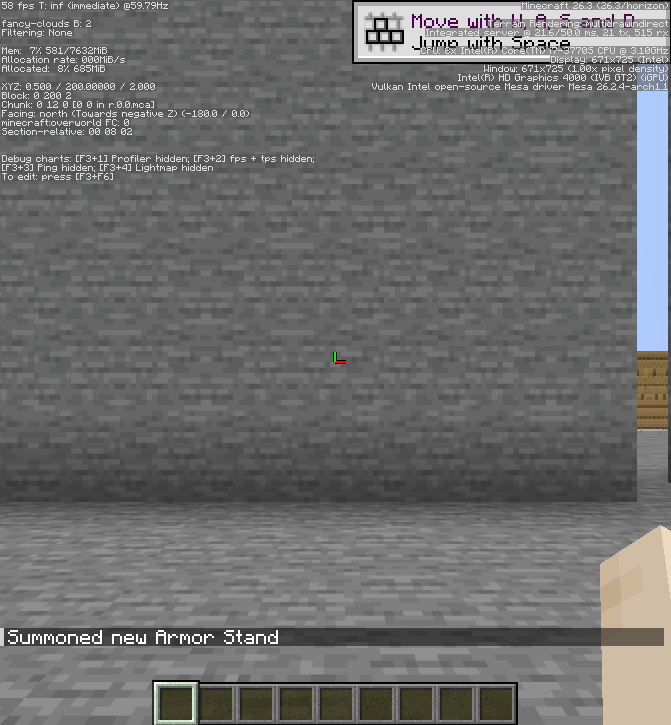
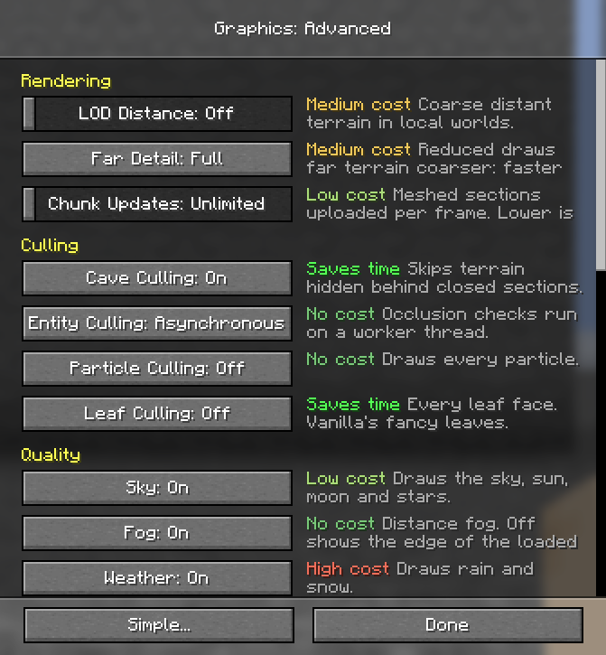

# Async culling benchmark

Run date: 2026-11-02.

## Setup

- Hardware: Intel Core i7-3770S (8 threads), Intel HD Graphics 4000 (IVB GT2), Intel Mesa Vulkan driver; Linux / Hyprland.
- Build: `cargo build --profile fast -p horizon-client -p horizon-client-lib --bins` (successful).
- Scene: a 32 × 32 stone platform at Y=199, a 32-wide stone wall at Z=-5 with one open column, and 5,000 stationary armor stands packed behind the wall. Each mode used a clone of the same saved world. Counts were reduced from 5,000 to 2,000, 500 and 91 between samples.
- Camera: fixed at (0.5, 200, 2), yaw 180°, pitch 0°, world time 6000; render distance 2, VSync off, 260 FPS cap. F3 reports a 671 × 725 game viewport at 100% pixel density; the desktop tiled the requested window.
- Each sample used a 2-second warm-up followed by a 6-second measurement. Async ran before Sync. These are single samples from one synthetic scene, not a multi-run average.

## Results

| Stands | Mode | Average FPS | 1% low FPS | CPU average | Frame p50 | Frame p95 |
|---:|---|---:|---:|---:|---:|---:|
| 91 | Async | 187.08 | 97.35 | 0.96 ms | 4.29 ms | 8.28 ms |
| 91 | Sync | 171.92 | 94.70 | 1.43 ms | 4.87 ms | 8.69 ms |
| 500 | Async | 185.55 | 106.57 | 1.22 ms | 4.39 ms | 8.29 ms |
| 500 | Sync | 150.12 | 92.98 | 3.32 ms | 6.18 ms | 9.26 ms |
| 2,000 | Async | 166.38 | 90.62 | 2.42 ms | 5.21 ms | 9.03 ms |
| 2,000 | Sync | 57.02 | 46.62 | 17.29 ms | 17.49 ms | 19.06 ms |
| 5,000 | Async | 66.60 | 36.16 | 14.68 ms | 14.98 ms | 17.54 ms |
| 5,000 | Sync | 26.19 | 17.68 | 37.79 ms | 36.93 ms | 43.22 ms |

The 2,000-entity Async sample averaged about 2.9× Sync FPS, with 86% lower measured CPU time. At 5,000 it averaged about 2.5× Sync FPS, with 61% lower measured CPU time. Smaller scenes show smaller differences. This benchmark is CPU-side and workload-specific; the Intel driver returned no usable GPU timestamp measurements, so it does not establish a GPU-time improvement.

## Cache counters

The previous four-way cache generated repeated evictions in this stationary workload: about 87 cache misses and evictions per frame at 500 entities, and 358 misses per frame with 158,952 evictions over the 2,000-entity sample. The sorted bounded cache recorded zero misses and zero capacity evictions at 500 and 2,000 after warm-up. At 5,000 it recorded 1,125 misses across the sample and zero capacity evictions, while serving about 3,523 queries per frame. The worker therefore did not need to complete a new job in most measured frames after the cache warmed.

## Screenshots

The F3 screenshots include the live FPS counter and show the same camera and scene with 2,000 stands. One witness stand is aligned with the wall opening to show that visible entities remain visible.

